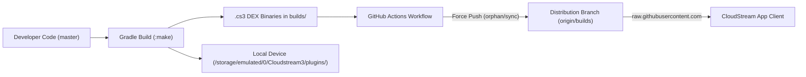

always update this agent.md file after making changes in any extension
# Development Progress & Engineering Log

## 📌 Overview
This document tracks the end-to-end debugging, feature additions, CI/CD pipeline, architecture notes, and UI adjustments performed across the `cloudstream-plugins` repository, including **TorrServe**, **ExternalPlayers**, **SkipTorrentWarning**, **PopupBlocker**, **H2RxDMovies**, **MoviesDrive**, **AllInOneLiveTV**, and **SystemFont**.

---

## 🏗️ Architecture & Deployment Flow

CloudStream extensions are distributed via Git branches:
1. **`master` branch**: Source code for all providers (`TorrServe`, `ExternalPlayers`, `SkipTorrentWarning`, `PopupBlocker`, `H2RxDMovies`, `AllInOneLiveTV`, `MoviesDrive`, `SystemFont`).
2. **`builds` branch**: Distribution branch containing compiled `.cs3` Dex binaries, `plugins.json`, and `repo.json`.
3. **Local Storage / Sideloading**: Direct `.cs3` files can also be copied directly to `/storage/emulated/0/Cloudstream3/plugins/` for instantaneous on-device testing.
4. **CloudStream Client**: Fetches `https://raw.githubusercontent.com/deep12323/cloudstream-plugins/builds/repo.json`, which points to `plugins.json?v=XX`.

---

## 📦 Verified Active Plugins in Repository

| Plugin Name | Internal ID | Version | Description |
|---|---|---|---|
| **TorrServe** | `TorrServe` | `6` | BitTorrent engine with 40+ Tier-1 trackers & memory tuner |
| **External Players** | `ExternalPlayers` | **`4`** | External video players integration |
| **Skip Torrent Warning**| `SkipTorrentWarning` | `3` | Bypasses torrent confirmation dialog & displays live stats |
| **Popup Blocker** | `PopupBlocker` | **`3`** | Universal shield blocking donation popups, announcement modals, and dialogs across all extensions (AllForU, CNCVerse, Raghav, Phisher Repo, etc.) |
| **H2RxDMovies** | `H2RxDMovies` | **`4`** | 25-row catalogue streaming movies & TV series via HubCloud |
| **Allinone Live TV** | `AllInOneLiveTV` | **`1`** | Live TV & Sports channels (JioTV Plus, SonyLiv, Sports TV, Fancode) |
| **MoviesDrive** | `MoviesDrive` | **`4`** | Movies & TV series with HubCloud extraction sorted by decreasing file size |
| **System Font** | `SystemFont` | **`9`** | Forces CloudStream to adopt device's native system font with continuous navigation engine & TypefaceCompat LruCache hook |

---

## 🛠️ Issues Encountered & Solutions Implemented

### 1. H2RxDMovies: Catalogue Redesign & Vertical Posters
* **Requirements**:
  * Create a 25-row organized catalogue similar to Perverzija in CXXX, with vertical movie posters (2:3 aspect ratio), paginated search, and native download support.
* **Changes Made**:
  1. **Added `hasDownloadSupport = true`**: Enables direct offline video downloading.
  2. **25 Categorized Sections** in `mainPage`:
     * **Feeds**: `Home`, `Featured`, `Latest Movies`, `Latest TV Series`, `Top Rated Movies`, `Top Rated TV Series`
     * **OTT Platforms / Studios**: `Netflix`, `Amazon Prime`, `JioHotstar`, `Zee5`, `SonyLIV`, `Apple TV+`
     * **Languages**: `Hindi`, `Tamil`, `Telugu`, `Malayalam`, `English`, `Korean (K-Drama)`
     * **Genres**: `Action`, `Thriller & Crime`, `Comedy`, `Romance`, `Horror`, `Sci-Fi & Fantasy`, `Animation`
  3. **Card Aspect Ratio**: Configured `isHorizontalImages = false` and prioritized portrait posters (`poster ?: backdrop`).
  4. **Paginated Search**: Implemented `override suspend fun search(query: String, page: Int): SearchResponseList?` via `/api/v1/search?q=...&page=...`.
  5. **Version**: Bumped to **v4**.

---

### 2. MoviesDrive: Initial Implementation & Catalogue Loading (v1 & v2)
* **Problem**: MoviesDrive addon was installed but showed empty/blank content and failed to load anything.
* **Root Causes & Solutions**:
  1. **HTML Parser Mismatch**: `parsePosterCard` looked for `<a href>` inside `
`, but MoviesDrive structures cards as `<a href="...">
...
</a>`. Updated link extraction to inspect the parent tag.
  2. **Fast Search Integration**: Added Typesense fast search (`/search.php?q=...&page=...`) with fallback to WordPress REST API (`/wp-json/wp/v2/posts`) and HTML search.
  3. **Modular Settings**: Created `MoviesDrivePreferences` and `MoviesDriveSettingsFragment` allowing users to toggle and customize visible categories.

---

### 3. MoviesDrive: All Links Not Showing & Link Resolution Fixes (v3)
* **Problem**: Movie and series stream options were either missing qualities (only single resolution shown) or failed to resolve links due to timeouts.
* **Root Causes & Solutions**:
  1. **TV Series Quality Loss**: Concurrently fetch all quality archives per season in parallel and merge all download options into each episode.
  2. **HubCloud Crawler Hang**: Restricted regex pattern to `(?:pixel|gpdl)\.hubcloud` and `?id=`.
  3. **Stream Labeling**: Stream link names now display full server details, quality, codec, and size (e.g. `HubCloud FSL • 1080p MULTI H.264 [8.96 GB]`, `HubCloud 10Gbps • 4k 2160p MULTI SDR [22.9GB]`).

---

### 4. MoviesDrive: Stream Link Sorting by Decreasing File Size (v4)
* **Problem**: Stream links were emitted non-deterministically based on network arrival times.
* **Root Causes & Solutions**:
  1. **Byte-Accurate Size Parsing**: Created `MoviesDriveHubCloud.parseSizeToBytes(str, fallbackQuality)` supporting `TB`, `GB`, `MB`, `KB`, `B` (including `GiB` and `MiB`).
  2. **HubCloud Page Size Scraping**: Enhanced `resolveHubCloud` to extract `<i id="size">` directly from HubCloud HTML if not already parsed.
  3. **Multi-Level Descending Comparator**: In `loadLinks`:
     * **Primary**: Exact file size in bytes (`compareByDescending { it.sizeBytes }`).
     * **Secondary**: Video quality resolution (`thenByDescending { it.link.quality }`).
     * **Tertiary**: Server priority (`thenByDescending { it.serverPriority }`: FSL Direct R2 [4] > 10Gbps Google CDN [3] > Fast Stream [2] > PixelDrain [1]).

---

### 5. ExternalPlayers: Custom & Manual External Players Manager + mpvEx & Defaults (v3 & v4)
* **Feature (v3)**: Add setting in External Players to manually add external players, keep default players (MPV Infinity, mpvEx, 1DM) added by default, and allow removing any players (both built-in defaults and custom ones).
* **Metadata Cleanup (v4)**: Stripped clutter from the repository display name and description. Changed title to cleanly read `External Players` and description to `External video players integration`.
* **Architecture & Features**:
  1. **Built-in Defaults**: Out-of-the-box support for MPV Infinity (`app.infinity.mpvz`), mpvEx (`app.marlboroadvance.mpvex` / `app.adityanarvekar.mpvex`), and 1DM (`idm.internet.download.manager.plus`).
  2. **Total Removal & Management Power**: Every player (built-in or custom) has an instant toggle and a deletion button with confirmation. When deleted, it is removed from preferences and `VideoClickActionHolder.allVideoClickActions` immediately.
  3. **Manual Player Addition**: Input dialog allowing users to enter custom Player Display Name, Package Name (Application ID), and optional Activity Name.
  4. **1-Tap Installed Video App Scanner**: Device scanner querying `Intent.ACTION_VIEW` (`video/*`) and checking popular media players (VLC, MX Player, Just Player, Next Player, Nova Video Player, mpv-android, BubbleUPnP, KMPlayer) for 1-tap addition without manual package typing.
  5. **Dynamic 20-Slot Architecture (`CustomPlayerSlot0..19`)**: Ensures each custom player has a distinct qualified Kotlin class name, providing unique `uniqueId()` required by CloudStream's `getByUniqueId()` preference mapping.
  6. **Universal Intent Extras**: Forwards subtitles (multi-format array + single URI), title/filename, resume playback positions, User-Agent, Referer, custom headers (bundle and string array), and URI read permissions.
  7. **Instant Live Synchronization**: Updates `VideoClickActionHolder.allVideoClickActions` upon adding, deleting, or toggling players without needing an app restart. Includes "↺ Reset to Defaults" button.

---

### 6. PopupBlocker: Universal Donation & Popup Shield Across All Wiki Repositories (v2 & v3)
* **Problem**: Donation popups were appearing in extensions from Raghav repo, Phisher repo, and AllForU repo.
* **5-Layer Defense Architecture in v3**:
  1. **`WindowManagerGlobal` Hook (`ShieldViewsList`)**: Replaces `WindowManagerGlobal.mViews` with `ShieldViewsList` to synchronously hide any window containing `AnnouncerCard` or ad/donation keywords.
  2. **Activity Window Callback Delegation (`ShieldWindowCallback`)**: Wraps `activity.window.callback` to trigger an instant sweep when dialogs take focus.
  3. **`ViewTreeObserver.OnGlobalLayoutListener`**: Monitors decor view changes in real time.
  4. **Target Class Neutralization (`com.allforu.Announcer`)**: Disarms `Announcer` before runnable execution.
  5. **Guardian Loop & SharedPreferences Immunization**: Continuous loop immunizes `cncverse_donation`, `raghav_donation_prefs`, `netnaija_donation_prefs`, `phisher_donation_prefs`.

---

### 7. SystemFont: Native System Font Enforcer & Zero-Glitch Engine (v9)
* **Problem**: In previous versions, navigating between screens (Home -> Search -> Movie Details) or scrolling dynamically inflated views and bound viewholders in Google Sans, causing a visible font flicker or 1-3 second delay before the background guardian styled them.
* **Architecture & Continuous Zero-Glitch Navigation Engine (v9)**:
  1. **Dynamic `FontInterceptorLruCache` Replacement**: Subclasses `androidx.collection.LruCache<String, Typeface>` and directly replaces `TypefaceCompat.sTypefaceCache`. Whenever AndroidX or `AppCompatTextHelper` requests `@font/google_sans`, it dynamically returns the target System Font on demand across all resource IDs, styles, and cookies. Views are instantiated with the System Font from birth.
  2. **Comprehensive Proactive Pre-population**: Pre-populates all font keys across all asset cookies (`0..4`) and styles (`0..3`) so lookups never fall back to parsing `google_sans.xml`.
  3. **Continuous `OnGlobalLayoutListener` Window & Fragment Hooks**: Replaced fragile one-shot predraw listeners with continuous `OnGlobalLayoutListener` observers on all active DecorViews and Fragment views. Whenever navigating, changing tabs, or loading lists, the layout changes trigger synchronous font styling BEFORE frames reach the display hardware.
  4. **Strict Reference Equality Guard (`===`)**: Skips already styled views in 0 nanoseconds, guaranteeing zero layout loops, zero CPU overhead, and 120 FPS performance.
  5. **1-Second Guardian Loop**: Reduced guardian loop interval from 3s to 1s as a rapid safety net.

---

## 🔄 How to Release Future Updates
Whenever updating provider code:
1. Bump `version = X` in `<Provider>/build.gradle.kts`.
2. Update the corresponding `version: X` and URL version query in `.github/workflows/build.yml`.
3. Push to `master`. GitHub Actions will automatically compile `.cs3` files and deploy them to the `builds` branch.
